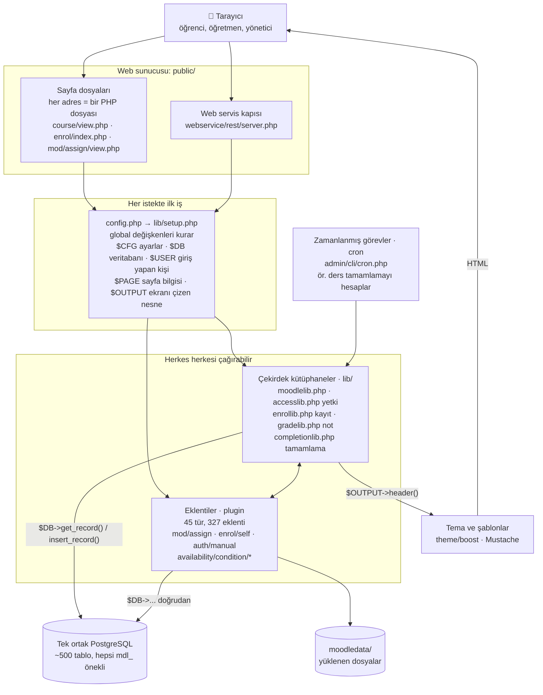
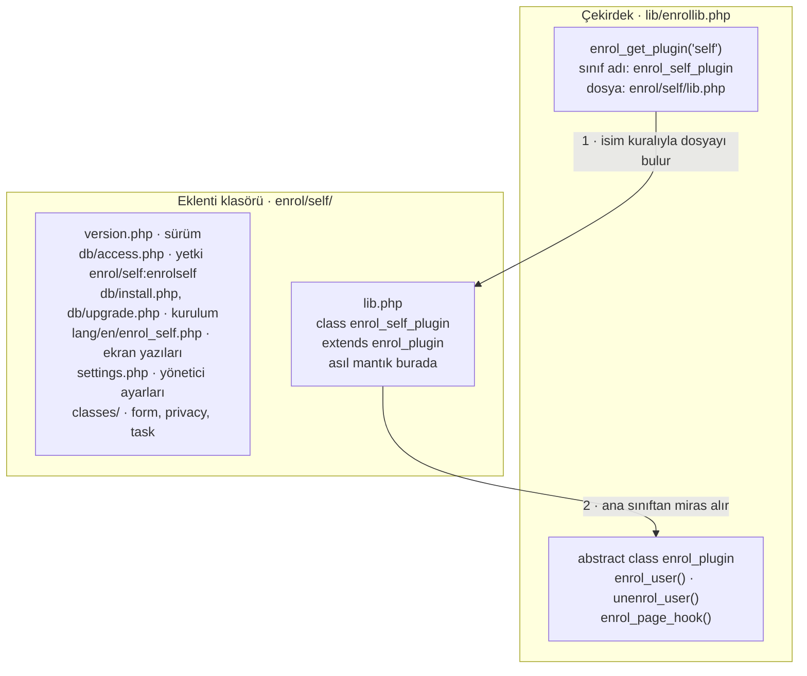
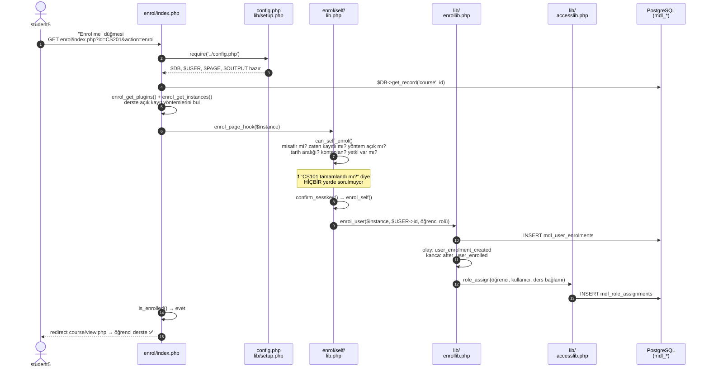
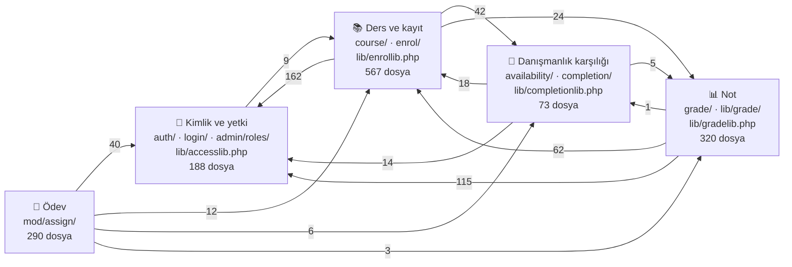

# 1. Moodle bugün nasıl çalışıyor? (eski sistem)

Bu dosyadaki her bilgi **Moodle 5.3.1** kaynak kodundan (`git clone -b v5.3.1 https://github.com/moodle/moodle.git`) kontrol edildi. Dosya yolları Moodle'ın `public/` klasörüne göredir; satır numaraları `v5.3.1` etiketindeki satırlardır. Kontrol edilmemiş ya da tahmin olan her şey **⚠️** ile işaretli.

İşaretler: ✅ kaynak koddan doğrulandı · 📏 bizim script'imizle sayıldı (yöntem altta) · ⚠️ doğrulanmadı / tahmin

---

## Diyagram 1: Moodle büyük resim

**Bunu şöyle anlat:**
> "Moodle tek parça büyük bir PHP programı. Tarayıcıda açtığınız her adres aslında bir PHP dosyası: `enrol/index.php` açarsanız o dosya çalışır. Her dosya ilk satırda `config.php`'yi çağırır; bu da ortak 'global' değişkenleri kurar: veritabanı `$DB`, giriş yapan kişi `$USER`, ekran `$OUTPUT`. Bundan sonra kodun herhangi bir yeri, başka herhangi bir yerin fonksiyonunu çağırabilir ve veritabanındaki herhangi bir tabloya doğrudan yazabilir. Bütün modüller tek bir ortak veritabanını paylaşıyor."
>
> Benzetme: Herkesin her odaya girebildiği, tek bir ortak deposu olan büyük bir ev.

**Kanıt:**
- ✅ `enrol/index.php:25` `require('../config.php');`, `public/config.php` kök `config.php`'yi, o da `lib/setup.php`'yi yükler (`config-dist.php` son satır).
- ✅ `lib/setup.php`: `$OUTPUT = new bootstrap_renderer();` (satır 653), `setup_DB();` (691), `\core\session\manager::start();` (905), `$PAGE = new $classname();` (1049). `$DB`, `$USER`, `$SESSION`, `$COURSE` burada `global` olarak tanımlanır (449-515).
- ✅ Veritabanı sürücüsü: `lib/dml/pgsql_native_moodle_database.php`; önek `mdl_` (`infra/moodle/config.php:15`).
- 📏 45 eklenti türü ve 80 alt sistem `lib/components.json`'da tanımlı; bu türlerin klasörlerinde `version.php`'si olan 327 eklenti var (alt eklentiler, ör. `assignsubmission_*`, sayılmadı).
- 📏 Testler hariç tüm `db/install.xml` dosyalarında 499 tablo tanımı var ("~500" diye söyle).
- ✅ Ders tamamlama hesabı cron'da: `lib/classes/task/completion_regular_task.php` (golden master README'si de bunu anlatıyor).

---

## Diyagram 2: Eklenti (plugin) nedir, bir eklentinin içi neye benzer?

Aynı türden kardeş eklentiler (✅ `enrol/` klasörü, 13 tane): `manual`, `self`, `guest`, `cohort`, `meta`, `category`, `database`, `ldap`, `lti`, `fee`, `paypal`, `flatfile`, `imsenterprise`.

**Bunu şöyle anlat:**
> "Moodle'ın gücü eklentiler. 'Derse kayıt' tek bir kod değil; 13 ayrı kayıt eklentisi var: öğretmenin elle eklemesi (`manual`), öğrencinin kendi kendine kaydolması (`self`), misafir, ödeme ile kayıt... Hepsi aynı ana sınıftan (`enrol_plugin`) türüyor. Moodle bir eklentiyi isminden buluyor: `self` diyorsa `enrol/self/lib.php` dosyasını açıp `enrol_self_plugin` sınıfını arıyor. Her eklentinin klasörü aynı düzende: sürüm dosyası, ana kod, yetkiler, ekran yazıları."
>
> Neden önemli: Bir kuralı 'kayıt sırasında' eklemek isterseniz, 13 eklentiye ayrı ayrı eklemeniz gerekir. Ön koşul özelliğinin (MDL-22648) 2012'den beri yapılamamasının sebebi bu.

**Kanıt:**
- ✅ `lib/enrollib.php:142` `enrol_get_plugin()`: `$class = "enrol_{$name}_plugin";` sonra `include_once("$location/lib.php")`.
- ✅ `lib/enrollib.php:1882` `abstract class enrol_plugin`; `enrol/self/lib.php:33` `class enrol_self_plugin extends enrol_plugin`.
- ✅ `enrol/self/db/access.php:77` `'enrol/self:enrolself'` yetkisi, `user` (giriş yapmış herkes) arketipine açık.
- ✅ 13 kayıt eklentisinin hiçbiri kayıttan önce başka bir dersin tamamlanmasına bakmıyor (`grep -il completion enrol/*/lib.php` 4 dosya buluyor; hepsi ders ayarı kopyalama ya da LTI not senkronu, ön koşul değil). Bkz. [advising SRS, REQ-ADV-08](../srs/modules/advising.md).

---

## Diyagram 3: Bir isteğin yolculuğu: "Öğrenci CS201 dersine kendi kendine kaydoluyor"

Senaryo: `student5` (Emre Doğan) CS101'i **tamamlamadı**. CS201'in tamamlama kuralında "önce CS101 tamamlanmış olmalı" yazıyor. Öğretmen CS201'e "Self enrolment" yöntemini eklemiş. Öğrenci "Enrol me" düğmesine basıyor.

**Bunu şöyle anlat:**
> "Öğrenci 'Beni kaydet' düğmesine bastığında `enrol/index.php` çalışıyor. Bu dosya önce ortak ayarları yüklüyor, sonra derste hangi kayıt yöntemleri açık diye bakıyor ve her birine 'sen bu sayfada ne göstermek istiyorsun' diye soruyor. Kendi kendine kayıt eklentisi birkaç kontrol yapıyor: misafir mi, zaten kayıtlı mı, tarih uygun mu, kontenjan dolu mu, yetkisi var mı. Hepsi tamamsa çekirdekteki `enrol_user()` fonksiyonunu çağırıyor; o da veritabanına iki satır yazıyor: 'bu kişi bu derse kayıtlı' ve 'bu kişinin bu derste rolü öğrenci'. Dikkat: bu yolun hiçbir adımında 'önceki dersi geçti mi?' sorusu yok. Bu yüzden CS101'den kalan öğrenci CS201'e girebiliyor."

**Kanıt (hepsi ✅, Moodle 5.3.1):**

| Adım | Dosya:satır |
|---|---|
| 2 | `enrol/index.php:25` `require('../config.php')` |
| 4-6 | `enrol/index.php:73-82` `enrol_get_plugins(true)`, `enrol_get_instances()`, `enrol_page_hook($instance)` |
| 7 | `enrol/self/lib.php:275` `can_self_enrol()`, `:296` `has_capability('enrol/self:enrolself', ...)`, `:310` `is_self_enrol_available()` (durum, tarih, yeni kayda açık mı, kontenjan, kohort) |
| 8 (not) | `enrol/self/lib.php` ve `enrol/index.php` içinde "completion" kelimesi hiç geçmiyor (`grep -c` = 0); `enrol_user()` içinde de yok |
| 9 | `enrol/self/lib.php:235-236` `confirm_sesskey()` sonra `$this->enrol_self(...)`; `:189` `$this->enrol_user(...)` |
| 11 | `lib/enrollib.php:2148` `$DB->insert_record('user_enrolments', $ue)` |
| 12 | `lib/enrollib.php:2155` `user_enrolment_created::create`, `:2171` `after_user_enrolled` |
| 13-14 | `lib/enrollib.php:2181/2183` `role_assign(...)`; `lib/accesslib.php:1651` `insert_record('role_assignments', ...)` |
| 15-16 | `enrol/index.php:87-94` `is_enrolled(...)` sonra `redirect($destination)` |

- ⚠️ Şifreli (enrolment key) kayıtta düğme bir açılır pencere (modal) formu açar (`enrol/self/lib.php:222-230`); bu diyagram şifresiz yolu gösteriyor. Canlı demoda şifre koymayın.

---

## Diyagram 4: Seçtiğimiz 5 modül Moodle'ın neresinde ve birbirine nasıl bağlı?

Kutular: modülün Moodle'daki klasörleri. Oklar: "A'daki kaç PHP dosyası B'nin tablosuna ya da fonksiyonuna **doğrudan** dokunuyor" 📏.

Tam tablo ve sayım yöntemi: [moodle-coupling/results.md](moodle-coupling/results.md), script: [moodle-coupling/measure_coupling.py](moodle-coupling/measure_coupling.py).

**Bunu şöyle anlat:**
> "Seçtiğimiz beş modül Moodle'da ayrı klasörlerde duruyor ama gerçekte birbirine sıkı sıkıya bağlı. Okların üstündeki sayı, bir modülün kaç dosyasının diğer modülün tablosuna ya da fonksiyonuna doğrudan dokunduğu. Örneğin ders ve kayıt modülünün 162 dosyası yetki koduna, not modülünün 62 dosyası ders tablolarına doğrudan erişiyor. Oklar iki yönlü de var: ders → danışmanlık ve danışmanlık → ders. Yani birini değiştirdiğinizde diğerleri de etkilenebilir; parçaları tek tek söküp yenisini takmak zor."
>
> Danışmanlık modülü Moodle'da yok; en yakın karşılığı "erişim kısıtlamaları" (`availability/`) ve "ders tamamlama" (`completion/`).

**Yöntem ve sınırları (📏):**
- Script Moodle'ın PHP dosyalarını düzenli ifadelerle (regex) tarıyor, PHP'yi gerçekten çözümlemiyor. Sayılar **yaklaşık**; şekli (kim kime bağlı, kabaca ne kadar) göstermek için kullanın, kesin değer gibi sunmayın.
- Bir dosya, B'nin bir tablosunun adını (`$DB->...('user_enrolments')` ya da SQL içinde `{user_enrolments}`) geçiriyorsa ya da B'nin bilinen bir fonksiyonunu çağırıyorsa (`has_capability`, `is_enrolled`, `grade_update`, `new completion_info` ...) sayılır. Her (A, B) çifti için bir dosya bir kez sayılır. Test dosyaları hariç.
- Hangi tablonun hangi modüle ait olduğu: eklenti tabloları kendi `db/install.xml` dosyasından, çekirdek tablolar elle atandı (listesi script'in başında).
- Ödev → not oku küçük çıkıyor (3) çünkü `mod/assign/locallib.php` tek başına çok büyük bir dosya; dosya sayıyoruz, çağrı sayısı değil.
- Yeniden üretmek için: `python3 docs/architecture/moodle-coupling/measure_coupling.py <moodle>/public`
