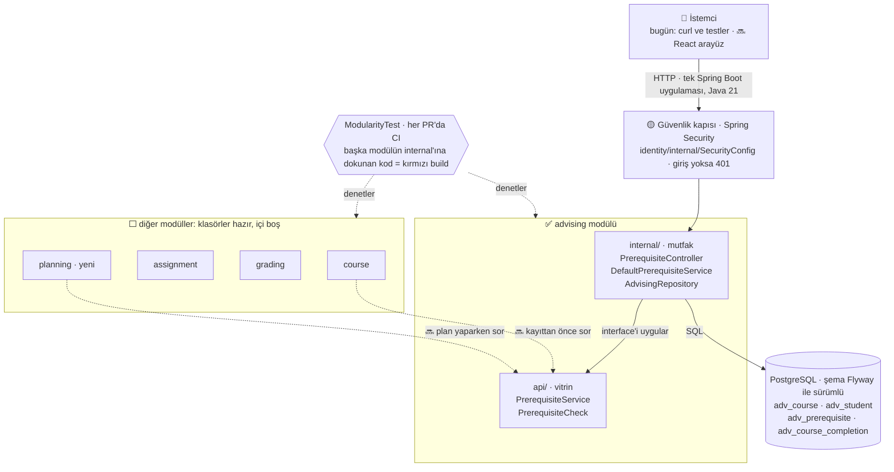
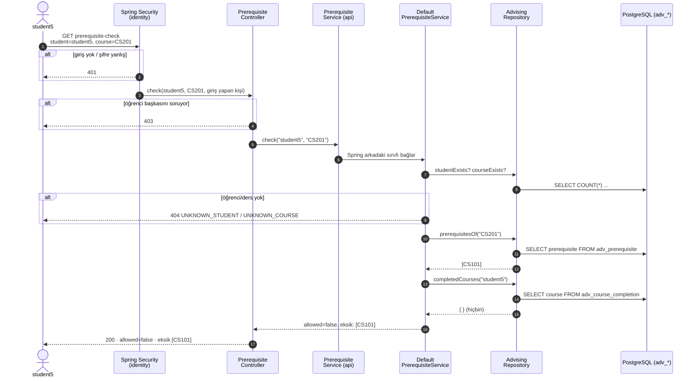
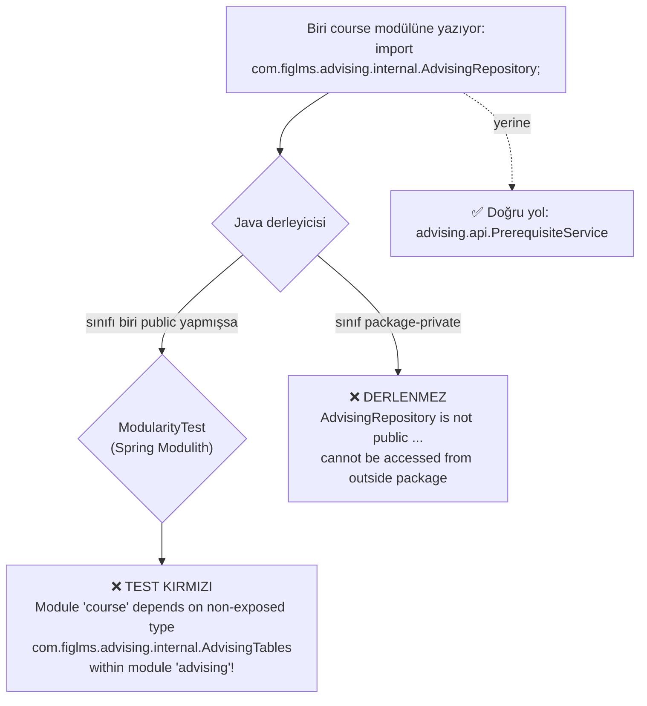

# 2. Yeni sistem: Fig LMS nasıl çalışıyor?

Kaynak: bu repodaki `backend/` (25 Kasım 2026 itibarıyla `main`), [ADR-0001](../adr/0001-language-and-architecture.md). Cevap örnekleri backend gerçekten çalıştırılarak alındı (PostgreSQL + `SAMPLE_USER_PASSWORD=demo`).

İşaretler: ✅ çalışıyor, kodda var · 🟡 geçici çözüm · ⬜ sadece iskelet (boş paket) · 🔜 planlandı, henüz kod yok

---

## Diyagram 5: Yeni sistem büyük resim



**Bunu şöyle anlat:**
> "Yeni sistem de tek bir program, yani hâlâ monolit; ama içi odalara bölünmüş. Altı modülümüz var: kimlik, ders, danışmanlık, ödev, not ve yeni eğitim planı. Her modülün iki bölümü var: `api` vitrin, `internal` mutfak. Başka bir modül sadece vitrinden alışveriş yapabilir, mutfağa giremez. Bu sadece bir söz değil: her PR'da çalışan `ModularityTest` testi mutfağa giren kodu bulursa build kırmızı oluyor ve kod birleşemiyor."
>
> "Bugün tam çalışan modülümüz danışmanlık: ön koşul kontrolü. Diğer modüllerin klasörleri hazır ama içleri boş. Ok kesikli çizilenler plan: ders modülü kayıttan önce danışmanlığa 'bu öğrenci girebilir mi?' diye soracak."
>
> Benzetme: Moodle'daki "herkesin her odaya girdiği ev" yerine, her odanın tek bir kapısı (api) olduğu ve kapı dışından girmeye çalışanı alarmın (CI) yakaladığı bir ev.

**Kanıt:**
- ✅ Modüller: `backend/src/main/java/com/figlms/{identity,course,advising,assignment,grading,planning}`, her birinde `api/` ve `internal/`. `ModularityTest.hasTheSixModulesFromAdr0001()` altısını kontrol ediyor.
- ✅ `advising/api/package-info.java`: `@NamedInterface("api")`. Diğer modüllerin dokunabileceği tek paket.
- ✅ `ModularityTest.verifiesModuleBoundaries()`: `ApplicationModules.of(FigLmsApplication.class).verify()`. CI: `.github/workflows/ci.yml` içinde `./mvnw -B verify`.
- ✅ Şema: `backend/src/main/resources/db/migration/V1__advising_prerequisites.sql`, `V2__advising_sample_data.sql` (Moodle'daki örnek veriyle aynı: CS201 için CS101 gerekli; student1 ve student2 CS101'i tamamladı).
- 🟡 Giriş şimdilik HTTP Basic ve sabit örnek kullanıcılar (`SecurityConfig`). Kimlik modülü gerçek hesapları ve token'ı sonra getirecek.
- 🔜 course → advising ve planning → advising okları **henüz kodda yok**. Şu an modüller arasında hiç bağımlılık yok (`grep "^import com.figlms" backend/src/main` sadece advising'in kendi içini gösteriyor).
- ⚠️ Dürüst not: `ModularityTest` Java bağımlılıklarını denetler. Bir modülün SQL ile başka modülün tablosunu okumasını **otomatik yakalamaz**. Bunu şimdilik tablo önekiyle (`adv_`) ve kod incelemesiyle koruyoruz.

---

## Diyagram 6: Aynı soru yeni sistemde: "student5 CS201'e girebilir mi?"



Gerçek cevaplar (backend çalıştırılarak alındı, şifre `demo`):

```text
$ curl -u student5:demo "http://localhost:8080/api/advising/prerequisite-check?student=student5&course=CS201"
{"student":"student5","course":"CS201","allowed":false,"reason":"PREREQUISITES_MISSING","missingPrerequisites":["CS101"]}

$ curl -u student1:demo "http://localhost:8080/api/advising/prerequisite-check?student=student1&course=CS201"
{"student":"student1","course":"CS201","allowed":true,"reason":"PREREQUISITES_COMPLETED","missingPrerequisites":[]}

$ curl -u student1:demo "http://localhost:8080/api/advising/prerequisite-check?student=student1&course=MATH101"
{"student":"student1","course":"MATH101","allowed":true,"reason":"NO_PREREQUISITES","missingPrerequisites":[]}

$ curl -u student3:demo "...?student=student1&course=CS201"     # başkasını soruyor
HTTP 403

$ curl -u x:y "...?student=student1&course=CS201"               # yanlış giriş
HTTP 401

$ curl -u teacher1:demo "...?student=student9&course=CS201"     # olmayan öğrenci
{"message":"Unknown student: student9","error":"UNKNOWN_STUDENT"}   HTTP 404
```

**Bunu şöyle anlat:**
> "İstek önce güvenlik kapısından geçiyor: giriş yoksa 401, kapı açılmıyor. Sonra 'controller' denen karşılama masası soruyu alıyor: öğrenci başkasının durumunu soruyorsa 403. Sonra soru danışmanlık modülünün vitrinindeki `PrerequisiteService`'e gidiyor. Asıl işi arkadaki `DefaultPrerequisiteService` yapıyor: veritabanından 'CS201'in ön koşulları ne?' diye soruyor, cevap CS101; 'student5 hangi dersleri bitirdi?' diye soruyor, cevap hiçbiri. Sonuç: giremez, eksik CS101. Moodle'da aynı öğrenci düğmeye basınca derse giriyordu."
>
> "Kural tek bir yerde, tek bir dosyada: `DefaultPrerequisiteService`. Kayıt nasıl yapılırsa yapılsın (öğrenci kendisi, öğretmen, ileride toplu kayıt) hepsi bu tek yere soracak. Moodle'da kural 13 kayıt eklentisine dağılmak zorunda olduğu için yapılamamıştı."

**Kanıt:** ✅ `advising/internal/PrerequisiteController.java` (401/403/400/404 kuralları sınıf yorumunda), `advising/internal/DefaultPrerequisiteService.java`, `advising/internal/AdvisingRepository.java`. Testler: `PrerequisiteControllerTest`, `PrerequisiteServiceTest`.

- ⚠️ Not: 403 cevabının gövdesi Spring'in varsayılan hata biçiminde (`{"timestamp":...,"status":403,"error":"Forbidden",...}`), 404/400 ise bizim biçimimizde (`{"error":...,"message":...}`). Tutarsızlık; ileride düzeltilmeli.

---

## Diyagram 7: Kuralı bozmaya çalışırsak ne olur? (canlı gösterilebilir)



**Bunu şöyle anlat:**
> "Diyelim ki bir arkadaşımız ya da yapay zekâ kestirme yol denedi: ders modülünden danışmanlığın mutfağındaki veritabanı sınıfını doğrudan kullanmak istedi. İki kat koruma var. Birincisi Java derleyicisi: o sınıf dışarıya kapalı, kod derlenmiyor bile. İkincisi, biri o sınıfı yanlışlıkla açık (`public`) yapsa bile `ModularityTest` 'course modülü advising'in gizli bir sınıfına bağımlı' diye hata veriyor. Moodle'da bunun karşılığı yok: herhangi bir dosya herhangi bir tabloya `$DB` ile yazabiliyor."

**Kanıt:** ✅ İki deneme de 25 Kasım'da bu repoda çalıştırıldı, hata mesajları yukarıdaki gibi birebir. Canlı gösterim adımları: [04-canli-demo.md](04-canli-demo.md#adım-5).
