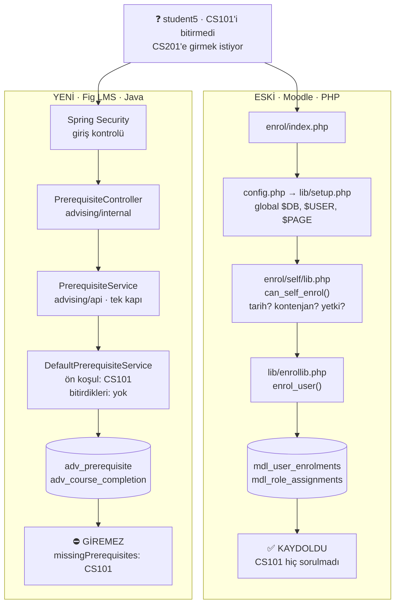
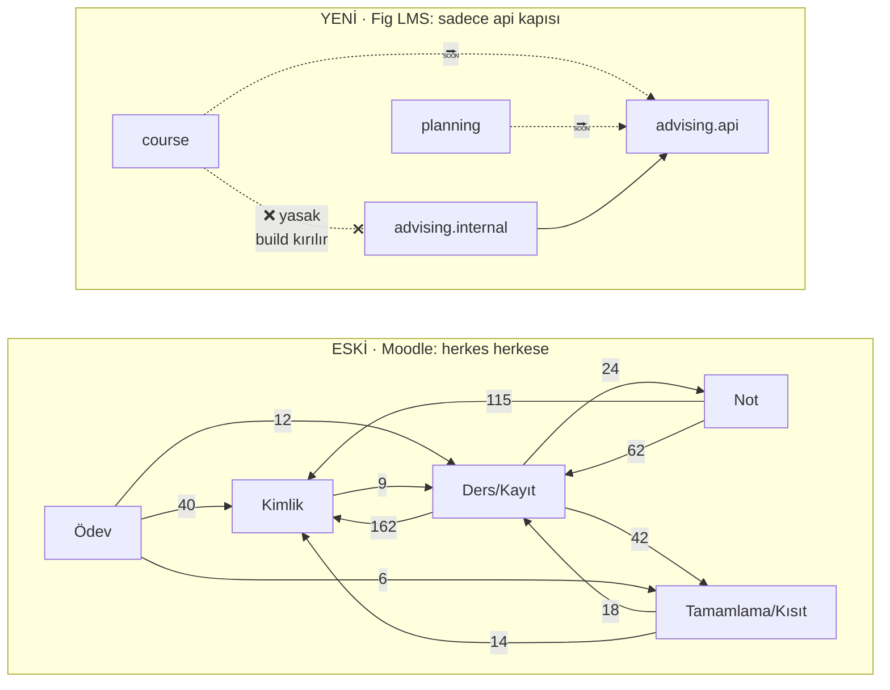
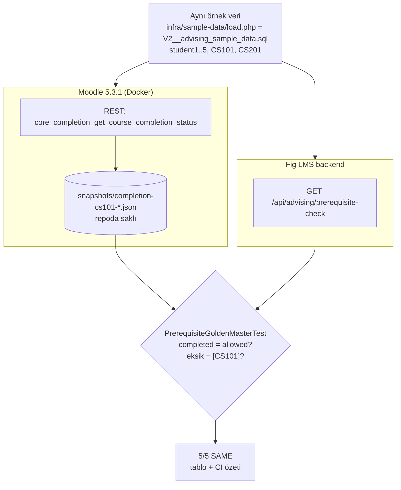

# 3. Eski ve yeni yan yana

## Diyagram 8: Aynı soru, iki sistem

Soru: **"CS101'i bitirmemiş student5, CS201'e girebilir mi?"**



**Bunu şöyle anlat:**
> "Aynı öğrenciyi, aynı dersi iki sisteme soruyoruz. Moodle'da istek beş adımdan geçiyor ve hiçbir adım 'önceki dersi bitirdi mi?' diye sormuyor; öğrenci derse giriyor. Bizim sistemde istek danışmanlık modülünün tek kapısından geçiyor; kural orada, öğrenci CS101'i bitirmediği için giremiyor ve sebebini de söylüyor. Bu Moodle'da 2012'den beri açık olan MDL-22648 isteği."
>
> Önemli: Bu bilinçli bir fark. Geri kalan her şeyde Moodle ile **aynı** sonucu vermemiz gerekiyor; bunu golden master testi gösteriyor (Diyagram 10).

---

## Tablo: Aynı konu, iki sistem

| Konu | Eski: Moodle 5.3.1 | Yeni: Fig LMS | Durum |
|---|---|---|---|
| Dil | PHP 8.3, tip kontrolü çalışırken | Java 21, tip kontrolü derlerken | ✅ |
| Genel yapı | Tek parça; her adres bir PHP dosyası; 45 tür eklenti | Tek parça (modüler monolit); 6 modül, her biri `api/` + `internal/` | ✅ iskelet hazır, 1 modül çalışıyor |
| Modüller birbirine nasıl ulaşır | Global `$DB` ile istediği tabloya, istediği fonksiyonu çağırarak | Sadece diğer modülün `api` paketinden | ✅ |
| Sınırı kim denetler | Kimse; sadece geliştirici alışkanlığı | Java derleyicisi + `ModularityTest` her PR'da | ✅ (SQL ile tablo erişimi otomatik denetlenmiyor ⚠️) |
| Veritabanı | Tek ortak şema, ~500 tablo, `mdl_` öneki | PostgreSQL, şema Flyway dosyalarıyla sürümlü, modül öneki (`adv_`) | ✅ |
| Bir istek nasıl işlenir | `enrol/index.php` → `config.php` → eklenti kancası → `enrollib.php` → DB | HTTP → Security → Controller → `api` Service → Repository → DB | ✅ |
| Yetki kontrolü nerede | Her sayfa kendisi çağırır: `require_login()`, `has_capability()` | Tek yerde: güvenlik filtresi + controller kuralı | 🟡 geçici giriş |
| Ön koşul kuralı | Yok. "Başka dersin tamamlanması" sadece tamamlamayı etkiler; kayıt 13 eklentiye dağınık | Tek sınıf: `DefaultPrerequisiteService`, herkes `PrerequisiteService`'e sorar | ✅ kural var · 🔜 kayıt akışı henüz yok |
| Moodle ile aynı mı? | Referans sistem | Golden master: 5 senaryonun 5'i aynı | ✅ |
| Arayüz | Moodle temaları, Mustache | React | 🔜 henüz yok |

---

## Diyagram 9: Bağımlılık haritası: dağınık ve kapılı



**Bunu şöyle anlat:**
> "Moodle kutusunda: seçtiğimiz beş bölümün dosyaları birbirinin tablolarına ve fonksiyonlarına doğrudan ulaşıyor; sayılar kaç dosyanın bunu yaptığını gösteriyor (küçük okları sadeleştirmek için çıkardık, tam tablo `moodle-coupling/results.md`'de). Fig LMS kutusunda: bir modül diğerine sadece onun vitrininden (`api`) ulaşabilir, mutfağa (`internal`) giden yol yasak ve test onu yakalıyor."
>
> Şunu da söyle: "Yeni sistemde şu an sadece bir modül dolu; Fig LMS kutusu bugün küçük göründüğü için temiz. Asıl kanıt, modüller doldukça bu kuralın CI'da kırmızı build ile korunması."

---

## Diyagram 10: Golden master: "Aynı girdi, aynı sonuç" nasıl kanıtlanıyor?



25 Kasım'da backend çalıştırılarak alınan gerçek çıktı:

```text
Scenario       Input                                              Moodle 5.3.1                             New system                              Result
Completed      student1 -> CS201 (CS101 passed with 85)           CS101 completed=true [snapshot]          allowed=true (PREREQUISITES_COMPLETED)  SAME
Not completed  student5 -> CS201 (CS101 not submitted)            CS101 completed=false [snapshot]         allowed=false (PREREQUISITES_MISSING)   SAME
Boundary       student3 -> CS201 (CS101 attempted, 40 < pass 50)  CS101 completed=false [snapshot]         allowed=false (PREREQUISITES_MISSING)   SAME
Boundary       student4 -> CS201 (CS101 submitted, not graded)    CS101 completed=false [snapshot]         allowed=false (PREREQUISITES_MISSING)   SAME
Unauthorized   student3 asks about student1                       denied (cannotviewreport) [Moodle rule]  denied (403)                            SAME

5/5 scenarios give the same result in Moodle and the new system.
```

**Bunu şöyle anlat:**
> "Yapay zekâ kodu yazabilir ama doğru yazdığını nereden bileceğiz? Cevabımız golden master: aynı öğrencileri, aynı dersleri hem Moodle'a hem bizim sisteme veriyoruz ve sonuçları makineye karşılaştırtıyoruz. Moodle 'student3 CS101'i tamamlamadı' diyor, biz de 'student3 CS201'e giremez, eksik CS101' diyoruz: aynı gerçek. Beş senaryonun beşi aynı."
>
> Sınırları da söyle: "Moodle tarafı canlı Moodle çalışıyorsa canlıdan, yoksa repodaki kayıtlı cevaplardan okunuyor; yetkisiz senaryo canlı çağrı değil, Moodle kaynak kodundaki kural (`completion_can_view_data()`) ile karşılaştırılıyor, çünkü örnek öğrencilerin web servis token'ı yok."
