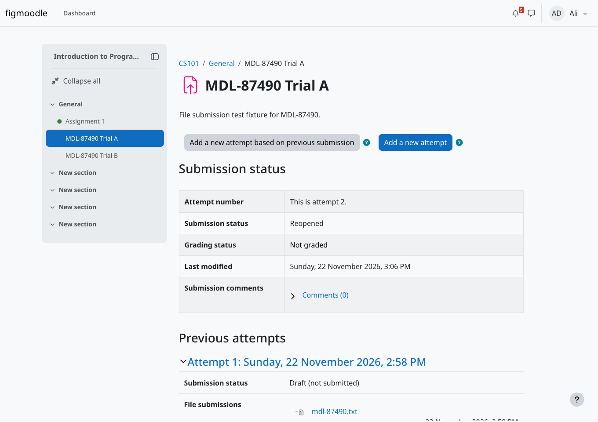

<!-- _class: title -->

# Moodle'ı yapay zekâyla yeniden yazmak kolay.<br>Aynı şekilde çalıştığını kanıtlamak zor.

## Fig LMS · 1. hafta · 25 Kasım 2026

<p class="muted">Sertug · Hasan · Efekan · Sercan · Oğuz</p>

---

<div class="who">Sertug</div>

# student3 CS101'den kaldı. Moodle onu yine de CS201'e kaydetti.

<div class="row">
<div class="card"><div class="mid red">40</div><p>CS101 notu<br>(geçme notu 50)</p></div>
<div class="card"><div class="mid red">Kayıtlı</div><p>CS201'de, Moodle 5.3.1</p></div>
<div class="card"><div class="mid">2012</div><p>Ön koşul isteği o yıldan beri açık<br>(MDL-22648, 99 oy)</p></div>
</div>

<p class="muted">Kaynak: infra/sample-data, docs/srs/modules/advising.md</p>

---

<div class="who">Sertug</div>

# Yapay zekânın başka dile çevirdiği kod hatasız görünüyor ama çoğu zaman doğru çalışmıyor

<div class="row">
<div class="card"><p><strong>Çalışma 1 · küçük programlar</strong></p><div class="mid">47 / 100</div><p>En iyi durumda bile 100 çeviriden 47'si doğru çalıştı.<br><span class="muted">1.700 program, 5 dil (Pan vd., ICSE 2024)</span></p></div>
<div class="card"><p><strong>Çalışma 2 · gerçek projeler</strong></p><div class="mid">%25</div><p>Kodun %96'sı düzgün görünüyordu, ama sadece %25'inin doğru çalıştığı gösterilebildi.<br><span class="muted">10 Java projesi → Python (AlphaTrans, FSE 2025)</span></p></div>
</div>

<br>

Bu yüzden bizim için asıl soru şu: **yeni sistemin Moodle ile aynı davrandığını nasıl kanıtlarız?**

---

<div class="who">Sertug</div>

# Her kuralı önce Moodle'da deniyoruz, sonra yeni sistemde aynı sonucu arıyoruz

<p class="muted">Kural: Moodle'ın bir durumda ne yaptığı. Örnek: "Bitişi başlangıcından önce olan bir ders açılamaz."</p>

<div class="row" style="gap:10px">
<div class="step" style="text-align:left;font-size:23px;padding:16px"><strong>1. Moodle'da dene</strong><br>Bir betikle (script) Moodle'da böyle bir ders açmayı denedik. Moodle dersi açmadı.</div>
<div class="arrow" style="font-size:28px">→</div>
<div class="step" style="text-align:left;font-size:23px;padding:16px"><strong>2. Listeye ekle</strong><br>Kuralı numara verip yapılacaklar listemize yazdık: <code>REQ-CRS-02</code>. Yeni sistem bu listeye uymak zorunda.</div>
<div class="arrow" style="font-size:28px">→</div>
<div class="step" style="text-align:left;font-size:23px;padding:16px"><strong>3. Yeni sistemde kodla</strong><br>Kodu yapay zekâ yazıyor. Ekipten biri inceleyip onaylıyor.</div>
<div class="arrow" style="font-size:28px">→</div>
<div class="step" style="text-align:left;font-size:23px;padding:16px"><strong>4. Karşılaştır</strong><br>Aynı isteği Moodle'a ve yeni sisteme gönderiyoruz. Cevaplar aynı olmalı.</div>
</div>

<div style="height:20px"></div>

**Bu hafta:** İlk iki adımı 5 modülde yaptık ve **41 kural** yazdık.
Son iki adımı şimdilik tek bir kuralda, ders ön koşulunda yaptık.

---

<div class="who">Sertug</div>

# Yeni sistemi Java ile yazıyoruz, çünkü derleyici yapay zekânın hatalarını erken yakalıyor

Bir araştırmada yapay zekâya gerçek projelerdeki hatalar verilmiş. Çözebildiği hataların oranı:

<div class="row">
<div class="card"><div class="mid">%23,4</div><p>Java</p></div>
<div class="card"><div class="mid" style="color:#7b8794">%11,6</div><p>TypeScript</p></div>
<div class="card"><div class="mid" style="color:#9aa5b1">%5,1</div><p>JavaScript</p></div>
</div>

<p class="muted">Kaynak: Multi-SWE-bench (Zan vd., 2025)</p>

Java'da derleyici, birçok hatayı kod daha çalışmadan bulur. Sistemi modüllere ayırdık: Bir modül başka bir modülün iç koduna erişirse **otomatik kontrol hata verir**.

---

<div class="who">Hasan</div>

# Kurduğumuz Moodle'da yanlış şifre kaç kez girilirse girilsin hesap kilitlenmiyor

<div class="row">
<div class="card"><div class="mid red">Kapalı</div><p>Hesap kilitleme ayarı<br><strong>Hedefimiz:</strong> 15 dakikada 5 yanlış şifreden sonra hesabı kilitlemek</p></div>
<div class="card"><div class="mid">8 saat</div><p>Hiçbir şey yapmayan kullanıcının oturumu bu kadar açık kalıyor<br><strong>Hedefimiz:</strong> en fazla 2 saat</p></div>
</div>

<br>

Yetkiler ise doğru çalışıyor. Öğrenci olarak giriş yapıp adres çubuğundaki dersi elle değiştirdik: Kayıtlı olmadığımız derse giremedik, not verme sayfası da açılmadı.

---

<div class="who">Efekan</div>

# Moodle, "CS101" varken "cs101" kodlu ikinci bir dersin açılmasına izin veriyor

<div class="row">
<div class="card"><div class="mid">45 / 45</div><p>Ders ve ders kaydı kurallarını bir betikle çalışan Moodle'da denedik. 45 kontrolün 45'inde Moodle, yazdığımız kurallara uydu.</p></div>
<div class="card"><p><strong>Bu sırada bulduğumuz iki zayıflık</strong></p><p>1. Ders kodunun tekrar etmemesi veritabanında değil, yalnızca PHP kodunda kontrol ediliyor.</p><p>2. Bitiş tarihi başlangıcından önce olan bir ders kaydı kabul ediliyor, ama hiçbir zaman geçerli olmuyor.</p></div>
</div>

<br>

Yeni sistemde bu iki kuralı **veritabanı da** zorunlu tutacak. Büyük-küçük harf konusuna ekipçe karar vereceğiz.

---

<div class="who">Sercan</div>

# Öğretmen bir ödev teslimini "taslağa geri alınca" öğrenciye fazladan bir deneme hakkı açılıyor

<div class="row">
<div style="flex:0 0 46%">



</div>
<div style="flex:1;display:flex;flex-direction:column;gap:18px">
<div class="card"><p><strong>Beklenen</strong></p><p>Öğrenci 1. denemesini düzeltir ve yeniden gönderir.</p></div>
<div class="card"><p><strong class="red">Moodle'da olan</strong></p><p>2. deneme açıldı. Dosya 1. denemede kaldı ve öğrenci onu düzenleyemiyor.</p></div>
</div>
</div>

<p class="muted">Bu, Moodle'ın bilinen ve hâlâ açık bir hatası (MDL-87490). Moodle 5.3.1'de tarayıcıda adım adım tekrarladık; ekran görüntüsü öğrencinin sayfasından.</p>

---

<div class="who">Oğuz</div>

# Ders listeleme izni kapatılınca öğrenci, kayıtlı olduğu derslerin kategorisini de göremiyor

<div class="row">
<div class="card"><p><strong>student1</strong> (CS101 ve CS201'e kayıtlı öğrenci)</p><div class="mid red">404 hatası</div><p>Kategori sayfası açılmıyor. Beklenen: kendi derslerini ve kategorisini görmesi.</p></div>
<div class="card"><p><strong>admin</strong> (yönetici)</p><div class="mid green">Hepsi</div><p>Tüm kategorileri ve dersleri görüyor.</p></div>
</div>

<br>

Bu da Moodle'ın bilinen ve hâlâ açık bir hatası (MDL-85503). Yazdığımız betik hatayı tek komutla tekrarlıyor.

<p class="muted">Not hesaplama kurallarını da çalışan Moodle'da bir betikle denedik: 18 kontrolün 18'i geçti.</p>

---

<div class="who">Efekan</div>

# Yeni sistemi kıyaslayabilmek için önce Moodle'ın bugünkü değerlerini ölçtük

<div class="row">
<div class="card"><div class="mid">%30,8</div><p>Moodle'ın kendi testleri, incelediğimiz kodun bu kadarını çalıştırıyor.<br><strong>Hedefimiz:</strong> en az %80</p></div>
<div class="card"><div class="mid">115,8 ms</div><p>Giriş süresi: Girişlerin %95'i bundan kısa sürdü.<br><strong>Hedefimiz:</strong> Moodle'dan yavaş olmamak</p></div>
<div class="card"><div class="mid">8 tık</div><p>Öğretmenin bir ödev oluşturmak için yaptığı tıklama sayısı.<br><strong>Hedefimiz:</strong> 6 tık</p></div>
</div>

<br>

Toplam **26 ölçüt (KPI)** belirledik: bakım kolaylığı, güvenlik, hız ve kullanım kolaylığı.
<p class="muted">Hızı tek bilgisayarda ve az veriyle ölçtük. Bu sayılar yalnızca aynı koşulda ölçülen yeni sistemle karşılaştırılabilir.</p>

---

<div class="who">Sertug · canlı demo</div>

# Aynı öğrenciyi yeni sisteme sorduk: "CS201'e kaydolamaz, önce CS101'i geçmeli"

Yazdığımız ilk kod tek bir soruyu cevaplıyor: **"Bu öğrenci bu derse kaydolabilir mi?"** student3 ve CS201 için soruyoruz:

```bash
curl -u student3:*** ".../api/advising/prerequisite-check?student=student3&course=CS201"
```
```json
{ "allowed": false,                      ← kaydolamaz
  "reason": "PREREQUISITES_MISSING",
  "missingPrerequisites": ["CS101"] }    ← eksik ön koşul dersi
```

Bu kontrolü **21 otomatik test** sınıyor. Henüz derse kayıt işlemine bağlı değil; sıradaki işimiz bu.

---

<div class="who">Oğuz</div>

# Beş durumun beşinde yeni sistemin kararı, Moodle'daki bilgiyle uyuşuyor

<p style="font-size:25px">Moodle, öğrencinin CS101'i tamamlayıp tamamlamadığını kaydediyor, ama derse kayıtta buna bakmıyor. Testimiz Moodle'daki bu bilgiyi yeni sistemin kararıyla karşılaştırıyor.</p>

<style scoped>table { font-size: 24px; }</style>

| Öğrencinin durumu | Moodle'daki bilgi | Yeni sistemin kararı |
|---|---|---|
| CS101'i 85 ile geçti | tamamladı | CS201'e kaydolabilir |
| CS101 ödevini teslim etmedi | tamamlamadı | kaydolamaz |
| CS101'den 40 aldı (geçme notu 50) | tamamlamadı | kaydolamaz |
| Teslim etti, notu henüz verilmedi | tamamlamadı | kaydolamaz |
| Başka bir öğrenciyi soruyor | bilgi verilmez * | cevap verilmez |

<p class="muted">* Bu satırda Moodle'a canlı sormadık; Moodle'ın kaynak kodundaki kuralı esas aldık.<br>Test, her kod değişikliğinde otomatik çalışıyor. Sistemi bilerek bozduğumuzda farkı satır satır gösterdi.</p>

---

<div class="who">Sertug</div>

# Karşılaştırma düzeni hazır, sıra modülleri yazmakta

<div class="row">
<div class="card"><p><strong>Bu hafta yaptıklarımız</strong></p><p>Moodle'ın 41 kuralını yazdık, çoğunu çalışan Moodle'da denedik.</p><p>26 ölçüt belirledik, Moodle'daki değerlerini ölçtük (biri eksik).</p><p>İlk kodu yazıp Moodle ile karşılaştırdık: 5 durumun 5'i uyuşuyor.</p></div>
<div class="card"><p><strong>Sıradaki işler</strong></p><p>Ön koşul kontrolünü derse kayıt işlemine bağlamak.</p><p>Koruduğumuz her kural için bir karşılaştırma testi yazmak.</p><p>İki Moodle hatasını düzeltmek: önce hatayı gösteren test, sonra düzeltme.</p></div>
</div>

<div style="height:20px"></div>

**Size sorumuz:** Yapay zekâ destekli geliştirme ile elle geliştirmeyi hangi alt fonksiyonda karşılaştıralım?

<p class="muted">Henüz yapmadıklarımız: eğitim planı gereksinimleri, arayüz, "derse kendi kendine kayıt" akışının kullanılabilirlik ölçümü, ZAP güvenlik taraması.</p>

---

<!-- _class: backup -->

# Kapsam: 6 modül

| Modül | Kapsamdaki akışlar | Gereksinim | Sahibi |
|---|---|---:|---|
| Kimlik ve yetki | Giriş, 3 rol, ders düzeyinde yetki | 7 | Hasan |
| Ders ve kayıt | Ders, kategori, öğretmen atama, kayıt | 9 | Efekan |
| Danışmanlık | Ön koşul (MDL-22648), danışman onayı, kredi sınırı | 9 | Sertug |
| Ödev ve teslim | Tarihler, dosya teslimi, geç teslim, deneme hakkı | 8 | Sercan |
| Değerlendirme | Not verme, ağırlıklı ortalama, kendi notunu görme | 8 | Oğuz |
| Eğitim planı (yeni) | Ön koşul ve kredi sınırından dönem planı | henüz yok | Sertug |

Moodle sürümü `v5.3.1` (`cfe123f2`). Analiz edilen kod (ilk 5 modül): 165.493 satır PHP. SRS ISO/IEC/IEEE 29148 yapısında, gereksinim → issue → kod → test izlenebilirlik matrisi `docs/srs/traceability.md`.

---

<!-- _class: backup -->

# KPI baseline (Moodle 5.3.1)

| Kategori | KPI | Moodle | Hedef |
|---|---:|---|---|
| Bakım yapılabilirlik | 5 | Ort. karmaşıklık 3,3–4,8; en yüksek 31–107; test kapsamı %24,3–60,3 (5 modül %30,8) | ort. ≤ 3,0; her metot ≤ 15; kapsam ≥ %80 |
| Güvenlik | 11 | Yetkisiz URL reddedildi; kilit kapalı; oturum 8 saat | %100 red; 15 dk'da 5 hata → kilit; oturum ≤ 2 saat |
| Performans | 6 | Giriş p95 115,8 ms; ders sayfası p95 40,4 ms; 20 eşzamanlı kullanıcı p95 158,5 ms, %0 hata | Moodle'dan yavaş olmamak |
| Kullanılabilirlik | 4 | Tık: ödev teslimi 6, not görme 2, ödev oluşturma 8, notlama 7 | 6, 2, 6, 5 |

Araçlar: lizard, cloc, PHPUnit + PCOV, k6 (3 tekrar, medyan), Moodle'ın yetki fonksiyonları, insan tarafından yapılan akış sayımı. Güvenlik bir sertifikasyon değil; ZAP taraması yapılmadı. Tüm tablo: `docs/srs/kpi.md`.

---

<!-- _class: backup -->

# Mimari kararı ve YZ kullanım kaydı

**ADR-0001:** Java 21 + Spring Boot 3, modüler monolit (Spring Modulith), PostgreSQL, React.
- Tip sistemi LLM çıktısındaki derleme hatalarını yarıdan fazla azaltıyor (Mündler vd., PLDI 2025)
- `ApplicationModules.verify()` her PR'da modül sınırlarını kontrol ediyor
- 5 kişi, 7 hafta: mikroservis yerine tek parça (Fowler, *Monolith First*)
- Sınırlılık: benchmark hata düzeltmeyi ölçüyor, sıfırdan yazmayı değil

**YZ kaydı (`docs/ai-log/`):** bu hafta 18 görev kaydı. Her kayıtta model, bağlam, kabul / değiştirildi / reddedildi, süre ve review hatası var. Bazı kayıtlar hâlâ "pending" olduğu için kabul oranını henüz vermiyoruz.
